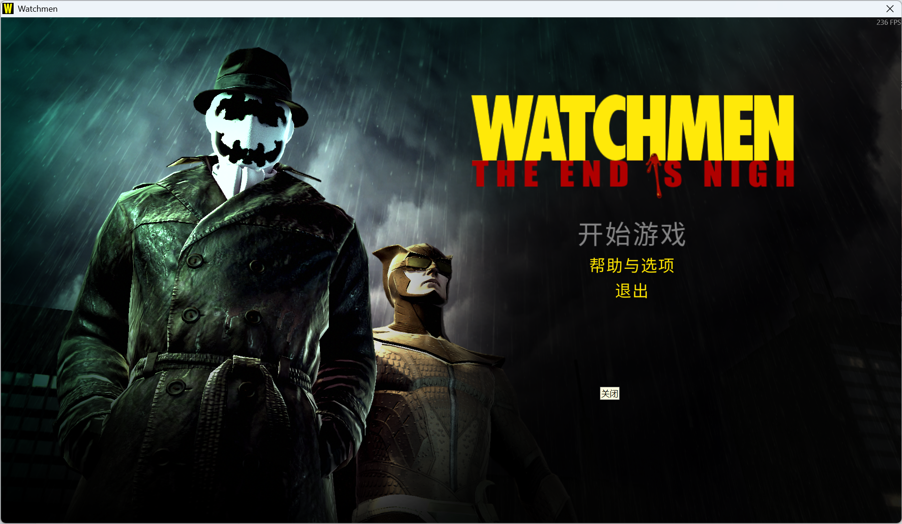
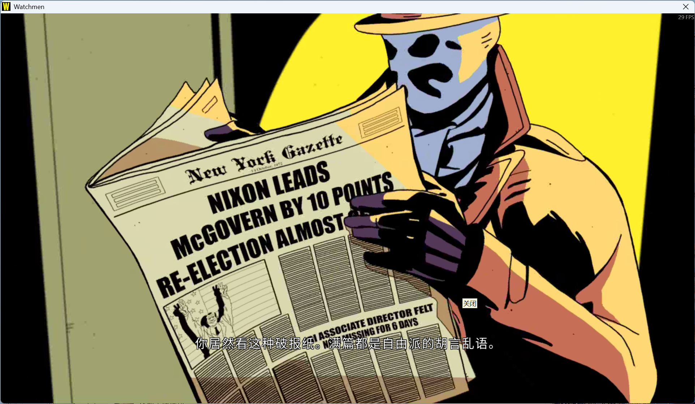
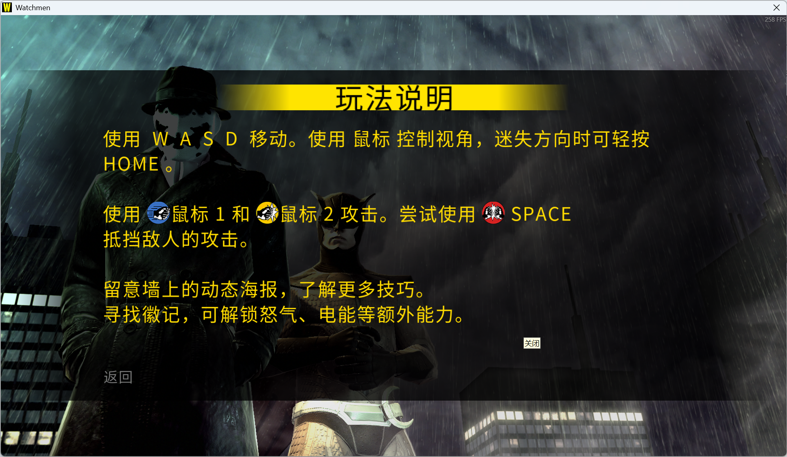
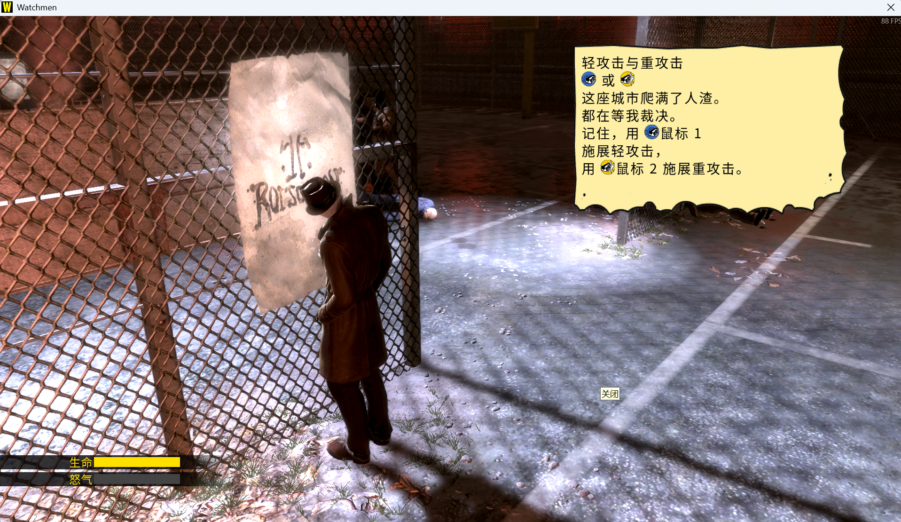
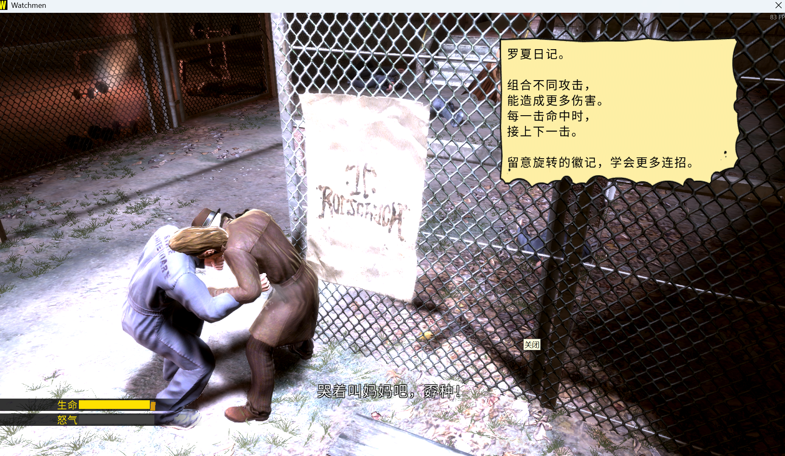

# 《守望者：终结将至》简体中文汉化

**Watchmen: The End Is Nigh · 第一部 · Steam版 · RC8测试版**

本项目提供非官方简体中文汉化，游戏内字体使用 **Source Han Sans SC（思源黑体简体中文版）**。目前为测试版，只测试了前三章，其他章节应该问题不大。

## 下载

- [下载RC8独立汉化包](https://github.com/newbility/Watchmen_The_End_is_Nigh_Chinese/raw/refs/heads/main/downloads/Watchmen_zh-CN_0.1.0-rc.8.zip)
- [查看下载目录](downloads/)
- [SHA-256校验清单](SHA256SUMS.txt)

请下载 `Watchmen_zh-CN_0.1.0-rc.8.zip` 并完整解压，再运行包内入口。

## 支持范围

- 仅适用于《Watchmen: The End Is Nigh》**第一部**，Steam AppID **21010**，当前验证版本Build **653**。
- 使用English语言槽；不会替玩家更改Steam语言、分辨率、键位、存档或Steam Cloud数据。
- 第二部不适用。安装器会校验游戏程序、资源版本及原件哈希；未知版本或已有不匹配修改时停止。
- Windows10/11 x64，使用系统自带Windows PowerShell5.1与.NET Framework4.x；**无需Python、Node、共享工具库、额外字体安装或联网下载运行环境**。

## 安装、校验与恢复

1. 完整解压汉化包到可写目录，退出游戏及分辨率设置启动器。
2. 双击 **打开汉化补丁.cmd**，选择第一部游戏根目录（包含 `data` 和 `derived_pc`）。可从Steam“管理 → 浏览本地文件”找到目录。
3. 点击“检查所选目录”，核对目标文件及备份位置，再点击“安装中文补丁”。
4. 正常通过Steam启动游戏，在分辨率设置窗口点击Play。

同一界面提供“校验中文 / 原件”和“恢复本次原件”。本补丁只替换一个文本/字体头资源文件；原件备份保存在所选游戏目录 `.watchmen-zh-cn/backups/original/WatchMen.block_h_z`。请保留 `.watchmen-zh-cn` 文件夹，恢复使用该次安装保存且哈希匹配的备份。无写权限时程序停止，不自动提权。

## 内容与验证范围

- 已完成78批已提取文本的翻译/校对，4417项已审校或精确保留输入，其中240项为空白、原生图标、物理键帽等保留条目，不能全部计为中文句子。
- 使用思源黑体，保留原生按键图标；人物称呼采用带中文双引号的“大人物”和“二老板”。
- 两角色分别执行53条技能说明与30条场内教程/装备海报的换行规则；罗夏8总行、夜枭9总行，标题、按键和空行计入。
- 本机19项安装/恢复、24项解码检查及实际GUI目录选择、安装、校验、恢复通过。字幕、菜单及部分教程有实际截图。
- 未逐项到达的海报按用户确认采用原“连招”框的同角色尺寸检查，不宣称所有技能已解锁或全部原场景均实测。全部章节字幕时序、真实手柄、真正4:3、完整存取档及独立清洁Windows仍未全面验收。
- 反馈请附游戏版本、分辨率、触发位置和截图：[提交Issue](https://github.com/newbility/Watchmen_The_End_is_Nigh_Chinese/issues)。

## 演示图片

以下为用户提供的游戏实际截图，原图保留。截图只展示对应场景。

### 中文主菜单

### 过场中文字幕

### 玩法说明与原生按键图标

### 罗夏攻击说明

### 罗夏连招海报与字幕

## 制作与来源

- 发布与测试：newbility；翻译为AI辅助流程，后续批次使用GPT-6 Luna初译、GPT-6.1 Sol校对，早期既有稿保留原来源。
- 字体：[Adobe Source Han Sans SC2.005](https://github.com/adobe-fonts/source-han-sans/releases/tag/2.005R)，SIL OFL1.1。
- 资源格式研究参考：[thurask/watchmen-toolkit](https://github.com/thurask/watchmen-toolkit)，MIT。
- 开发差分编码：[xdelta3](https://github.com/jmacd/xdelta)，Apache-2.0及其组件许可；玩家包使用包内托管解码器，不需要xdelta3或VC++开发运行库。
- 来源、组件许可及字体派生参数随汉化包保留，详见包内“来源与许可.md”、`licenses/` 和 `font-info/`。

# 版权与免责声明

1.本补丁仅供学习与交流使用，不得用于任何商业用途，请在已购买正版游戏的前提下使用。

2.游戏文本及资源的版权归开发者/发行商所有；中文译文采用 CC BY-NC-SA 4.0 协议；字体使用思源黑体简体中文版（Source Han Sans SC），遵循 SIL Open Font License 1.1。如有侵权，请联系移除。

3.本汉化包为非官方汉化程序，对于使用汉化包而造成的任何损失，本人不负任何责任。

4.您肯定已经详细阅读并已理解本协议，并同意严格遵守免责声明的各条款和条件。如不同意，请勿使用。

## 许可范围与联系

CC BY-NC-SA 4.0 仅适用于本项目中文译文，不适用于原游戏内容、思源黑体及第三方组件。字体和组件以各自随附许可证为准。

- 中文译文协议：https://creativecommons.org/licenses/by-nc-sa/4.0/deed.zh-hans
- 协议完整条款：https://creativecommons.org/licenses/by-nc-sa/4.0/legalcode
- 字体许可证：https://openfontlicense.org/open-font-license-official-text/
- 问题反馈与移除联系：https://github.com/newbility/Watchmen_The_End_is_Nigh_Chinese/issues
